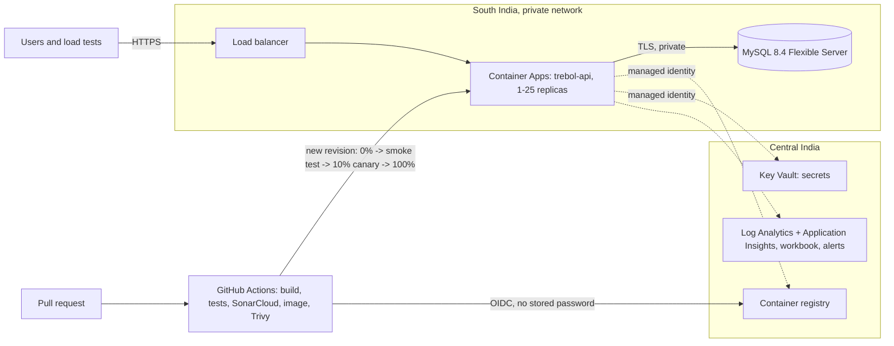

# Trébol API on Azure: containerize, deploy and scale a Java application

This repository takes **Trébol**, an open-source e-commerce REST API (Spring Boot 3.5, Java 17, MIT license, by the
Trébol eCommerce Project), and runs it in production style on **Azure Container Apps**: container image, CI/CD with
quality and security gates, infrastructure as code, private database, secrets in Key Vault, autoscaling, monitoring
and alerting. The target is **10,000 concurrent users at a P95 response time below 500 ms with fewer than 1% errors**.

The application itself lives in [`trebol-backend-monolith/`](trebol-backend-monolith/) (its own README there is the
upstream project's and partly outdated; [docs/01-analysis.md](docs/01-analysis.md) describes the app as it is now).

## Architecture



Two regions because Azure Database for MySQL Flexible Server is not available to the project's subscription in
Central India; the network, the database and Container Apps share South India, the shared services stay in Central
India. Details and reasons: [docs/03-infrastructure.md](docs/03-infrastructure.md).

## Repository layout

| Path | Content |
|---|---|
| `trebol-backend-monolith/` | The Spring Boot application (Maven), its `Dockerfile` and Flyway migrations |
| `infra/` | Bicep: `main.bicep` (infrastructure, deployed by the engineer), `app.bicep` (the container app, deployed by the release pipeline), `roles.bicep` (role assignments, subscription administrator) |
| `.github/workflows/` | `ci.yml` (reusable CI), `pr.yml` (every pull request), `deploy.yml` (every merge to `main`), `schedule.yml` (working hours) |
| `loadtest/` | JMeter plan and how to run it, including the evaluation-window runbook |
| `test-endpoints.sh` | Smoke test (48 checks), used locally and by every release |
| `compose.yaml`, `.env.example` | Local stack: the API with MySQL 8.4 |
| `docs/` | The documentation listed below |

## Run it locally

Requirements: JDK 17, Maven 3.9, Docker (for the image and MySQL), Git Bash or another bash for the smoke test.

```bash
# Build and test (372 unit tests, coverage gate)
cd trebol-backend-monolith && mvn -B verify && cd ..

# Run the WAR with the in-memory H2 database and its demo data
java -jar trebol-backend-monolith/target/trebol-backend-monolith-java17-0.2.5-SNAPSHOT.war

# Or the production-like stack: the image with MySQL 8.4 (copy .env.example to .env and fill it first)
docker compose up -d --build

# Smoke test against either
bash test-endpoints.sh http://localhost:8080
```

Swagger UI: `http://localhost:8080/swagger-ui/index.html`. The local demo accounts use known passwords (for example
`admin`/`admin`); in Azure they were all changed. More: [docs/01-analysis.md](docs/01-analysis.md) and
[docs/02-container.md](docs/02-container.md).

## How a change reaches production

1. Open a pull request into `main`: build, 372 tests, JaCoCo coverage gate, SonarCloud quality gate, image build,
   Trivy scan (no critical vulnerabilities) and push of the image. The branch rules require these checks.
2. Merge: the same gates run on `main`, then the release deploys `infra/app.bicep` with the new image as a new
   revision at 0% traffic, runs the smoke test on that revision's own URL, sends it 10% of the traffic for 2 minutes
   and promotes it to 100%; any failure rolls back automatically.
3. Weekdays 13:45 IST the schedule starts the database and the app, at 22:00 IST it stops them (cost rule).

Azure login uses OIDC federated credentials: no Azure password is stored anywhere. Details:
[docs/04-cicd.md](docs/04-cicd.md).

## Documentation

| Document | Topic |
|---|---|
| [01-analysis.md](docs/01-analysis.md) | The application: stack, build, configuration, security model, findings, assumptions |
| [02-container.md](docs/02-container.md) | Container image: Dockerfile design, local stack, vulnerability scan |
| [03-infrastructure.md](docs/03-infrastructure.md) | Azure architecture, resources, network, identities and secrets, deployment guide |
| [04-cicd.md](docs/04-cicd.md) | Pipeline: CI gates, release with canary and rollback, schedule, pipeline security |
| [05-scaling-monitoring.md](docs/05-scaling-monitoring.md) | Scaling and availability strategy, probes, logs and telemetry, dashboard, alert strategy |
| [06-load-test.md](docs/06-load-test.md) | Load test report, capacity estimate and tuning recommendations |
| [07-cost.md](docs/07-cost.md) | Cost analysis: measured cost, projection, evaluation window, teardown |
| [loadtest/README.md](loadtest/README.md) | How to run the JMeter plan; evaluation-window runbook |

## Status (16 Nov 2026)

| Area | Status |
|---|---|
| Analysis, container, infrastructure, CI/CD | Done and in use |
| Scaling, monitoring, alerts | Done; scale-out and scale-in, alerts and a zero-downtime release verified under load |
| Load test | Plan delivered; laptop test passed (P95 401 ms, 0.00% errors at 165 users); the official 10,000-user test is run by the evaluators |
| Planned | Catalog cache and query tuning before the official test; hardening (restricted database user, network security groups, Key Vault firewall, verified TLS to MySQL); Kubernetes (AKS) as phase 2 |

## Demo walkthrough

1. **The app**: health and a public endpoint over HTTPS (`/actuator/health/readiness`, `/public/about`), Swagger UI.
2. **A change end to end**: a small pull request, its checks (tests, SonarCloud, Trivy), the merge, the release with
   0% revision, smoke test, canary and promotion (GitHub Actions run and its summary).
3. **Revisions**: the old revision deactivated, the new one with 100% of the traffic (Azure portal, Container App,
   Revisions).
4. **Load and scaling**: a short JMeter run (`loadtest/README.md`) with the workbook "Trebol API operations" open:
   requests, P95, replicas 1 -> 3, CPU.
5. **Alerts**: the fired alerts and their e-mails (Azure portal, Monitor, Alerts).
6. **Infrastructure as code**: `infra/` and a what-if preview; costs in Cost Management ([docs/07-cost.md](docs/07-cost.md)).
