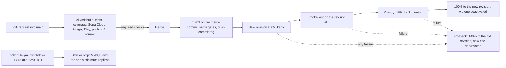

# Trébol backend: CI/CD pipeline

This document is the CI/CD deliverable of the POC (Requirement 3). It describes the GitHub Actions workflows that
build, test, analyse, scan and publish every change, release every merge to `main` to Azure Container Apps without
manual steps, and stop the environment outside working hours. Everything below was verified on 13 Nov 2026; the first
automatic release was commit `63ac839` (pull request #5).

## 1. Requirement checklist

| Requirement | How it is met | Evidence |
|---|---|---|
| On every pull request: build and unit tests | `mvn verify`: compile, 372 unit tests, JaCoCo coverage gate (20%) | `ci / Build, test and analyse` |
| Code quality | SonarCloud analysis; the job waits for the quality gate and fails if it fails | SonarCloud check and comment on every pull request |
| Image build and vulnerability scan | `docker build`, then Trivy (same version as locally, pinned by digest): report of critical and high findings, gate on critical | `ci / Image build, scan and push` |
| Push to a registry | Image pushed to Azure Container Registry as `trebol-api:pr-NUMBER-COMMIT` | Registry tags |
| On merge to `main`: deploy | `deploy.yml`: CI again on the merge commit, then a new Container Apps revision | Revision `trebol-api--r2-1-63ac839` |
| Smoke test | `test-endpoints.sh` (48 checks) against the new revision's own URL before it gets user traffic | Deploy job summary |
| Publish status | Commit status checks on GitHub, a job summary with image, revisions and smoke result | Pull request and run pages |
| No secrets in pipeline files | Azure login by OIDC (no password); IDs and the remaining secrets live in GitHub encrypted secrets | Section 6 |
| A merge to `main` reaches production with no manual steps | Merge of pull request #5: build, gates, image, release and promotion ran automatically in 13.4 minutes | Section 8 |
| Bonus: canary and automatic rollback | 10% of the traffic for 2 minutes before promotion; any failure moves all traffic back to the previous revision | Section 4 |

## 2. Overview

| File | Trigger | Purpose |
|---|---|---|
| `.github/workflows/ci.yml` | Called by the two workflows below (`workflow_call`) | Build, tests, coverage gate, SonarCloud gate, image build, Trivy gate, optional push |
| `.github/workflows/pr.yml` | Every pull request into `main` | Runs `ci.yml`; image tag `pr-NUMBER-COMMIT`; pushes only for pull requests from branches of this repository |
| `.github/workflows/deploy.yml` | Push to `main` (except documentation-only changes), manual run | Runs `ci.yml`, then releases the image as a new revision |
| `.github/workflows/schedule.yml` | Cron on weekdays, manual run (start or stop) | Working-hours schedule of the cost rule |
| `.github/scripts/aca-revision.sh` | Sourced by deploy and schedule | Revision helpers: current revision, exact traffic split, bounded waits, deactivation |
| `test-endpoints.sh` | Deploy job | Smoke test; exits non-zero on any failed check and deletes its test data |

The CI is written once (`ci.yml`) and called by both workflows, so pull requests and releases pass exactly the same
gates.

## 3. CI: build, quality and image

| Step | Detail |
|---|---|
| Checkout | Full history (`fetch-depth: 0`), so SonarCloud can tell new code from old; no persisted Git credentials |
| Java | Temurin 17 with Maven's dependency cache |
| Build and tests | `mvn -B -ntp verify`: 372 unit tests and the JaCoCo coverage check; the build fails below 20% coverage (actual: 84%) |
| SonarCloud | Maven plugin 5.8.0.7211, `sonar.qualitygate.wait=true`. Organization and project key are built from GitHub's own variables (owner, owner_repo), so no name is written in the workflow. Automatic analysis is off in SonarCloud so that only the pipeline analyses |
| Image | `docker build` of the multi-stage Dockerfile; tag = short commit id (with `pr-NUMBER-` for pull requests), so every image traces back to its code |
| Trivy | `aquasec/trivy:0.76.2` pinned by digest, run as a container (no third-party action). First run: report of critical and high findings. Second run: gate, exit code 1 on any critical finding not accepted in `.trivyignore.yaml` |
| Push | Azure login by OIDC, `az acr login`, `docker push`; the image reference goes to the job summary and to the deploy job |

Typical durations on the first release: build, tests and SonarCloud 127 s; image, scan and push 122 s.

## 4. Release: revisions, smoke test, canary, rollback

The Container App runs in multiple-revision mode: each release is a new, immutable revision with its own URL, and
traffic is moved between revisions explicitly. The deploy job (one at a time, see section 7):

1. **Pin** all traffic to the revision serving now, by name, so the new revision starts with 0%.
2. **Create** the new revision with the new image (`az containerapp update --image ... --revision-suffix rRUN-ATTEMPT-COMMIT`)
   and wait (bounded, up to 10 minutes) until it is provisioned and its readiness probe passes.
3. **Smoke test** the new revision on its own URL with the 48 checks of `test-endpoints.sh` (login, registration,
   permissions, product CRUD, product lists, cleanup). Users still reach only the old revision.
4. **Canary**: 90% old, 10% new for 2 minutes; every 15 seconds the new revision's readiness and health are checked.
5. **Promote**: 100% to the new revision; the old revision is deactivated (no replicas, no cost; it can be
   reactivated).
6. **Rollback** (only if a step after the creation failed): 100% back to the old revision, the new one deactivated,
   and the summary says so.

Traffic is written as an exact list through the Container Apps API, so no weights of old revisions are left behind
(the CLI command rescales weights it is not given and keeps their entries). The revision name tells which run and
commit produced it: `trebol-api--r2-1-63ac839` is run 2, attempt 1, commit `63ac839`.

The release needs the app's database: a release outside working hours (database stopped) fails its smoke test and
rolls back. Run the schedule's "start" first in that case.

## 5. Working-hours schedule

| Time (IST) | Cron (UTC) | Action |
|---|---|---|
| 13:45 Monday-Friday | `15 8 * * 1-5` | Start MySQL (waits until it runs), then move the app to a revision with 1 minimum replica |
| 22:00 Monday-Friday | `30 16 * * 1-5` | Move the app to a revision with 0 minimum replicas, then stop MySQL |
| Any time | manual run (`start` or `stop`) | Work outside the window, the evaluation |

The minimum replica count belongs to a revision, so the schedule creates a new revision with the same image and the
new minimum, moves the traffic to it and deactivates the old one, exactly like a release. Deactivating a revision
that still has traffic is avoided: it would leave a stale traffic weight. Each step is skipped when nothing has to
change, so a repeated run does no harm. GitHub can start scheduled runs some minutes late; weekends stay off.

## 6. Security of the pipeline

- **Azure login without a password (OIDC).** GitHub issues each run a short-lived signed token describing the run.
  Two federated credentials on the pipeline identity `id-trebol-github` accept it only for this repository:
  `repo:OWNER@ownerId/REPO@repoId:ref:refs/heads/main` (pushes, schedule, manual runs on `main`) and
  `repo:OWNER@ownerId/REPO@repoId:pull_request`. GitHub includes the numeric ids of the owner and the repository in
  the subject, so a deleted and re-created repository with the same name cannot inherit the trust. A manual run on
  any other branch cannot log in.
- **What the pipeline identity may do.** Contributor on the resource group only: push images, create revisions, move
  traffic, start and stop MySQL. It cannot assign roles and cannot read Key Vault secrets.
- **GitHub secrets.** `AZURE_CLIENT_ID`, `AZURE_TENANT_ID`, `AZURE_SUBSCRIPTION_ID` (not secret in themselves, but
  stored as secrets so GitHub masks them in the public logs), `SONAR_TOKEN`, and `TREBOL_ADMIN_PASSWORD` (the cloud
  admin password for the smoke test, copied from Key Vault without being displayed).
- **Public logs.** The repository is public, so its workflow logs are too: secret values are masked by GitHub, and the
  deploy job masks the app's host names (`::add-mask::`).
- **Least-privilege tokens.** Every workflow starts with `contents: read`; only the jobs that log in to Azure get
  `id-token: write`. Checkouts do not keep Git credentials.
- **Pull requests from forks** get neither secrets nor an Azure token: the push step runs only for pull requests from
  branches of this repository.
- **Supply chain.** Third-party actions are pinned to full commit ids (checkout v7.0.1, setup-java v6.2.0,
  azure/login v3.1.0; an annotated tag was resolved to its commit), the Trivy image to a digest and the Sonar plugin
  to a version. A moved tag cannot change what runs.
- **Branch rules on `main`** (repository ruleset): pull request required, both CI checks required, no force-push,
  no deletion.
- **Linting.** `actionlint` (including `shellcheck` of every `run:` block) and `shellcheck` of the scripts: no findings.

## 7. Concurrency

| Workflow | Group | Behaviour |
|---|---|---|
| `pr.yml` | `pr-NUMBER` | A new push to the same pull request cancels the run still going |
| `deploy.yml`, deploy job | `azure-trebol-api` | One change to the app at a time; a second release waits |
| `schedule.yml` | `azure-trebol-api` | Never runs during a release |

## 8. Verification and incidents (13 Nov 2026)

| Run | Result | What it showed |
|---|---|---|
| Pull request #4, first run | Build, tests, SonarCloud, image and scan passed; **Azure login failed** (`AADSTS700213`) | GitHub's token subject contains the numeric owner and repository ids; the credentials had the name-only form. Fixed in the Bicep parameters (pull request #4) |
| Pull request #4, second run | All green; image `pr-4-ff9bd93` pushed through OIDC | Login and push work without a stored password |
| First `deploy` on `main` | **Stopped at the SonarCloud quality gate**; Azure untouched | The first analysis of `main` judged existing code: security rating D from rule java:S4502 ("CSRF protection disabled"). Reviewed as not applicable (stateless API, token only in the Authorization header, no cookies) and documented in the code with `@SuppressWarnings("java:S4502")` and the reason (pull request #5) |
| `deploy` after pull request #5 | **Success** in 13.4 minutes: build 127 s, image 122 s, release 324 s; rollback skipped | New revision `trebol-api--r2-1-63ac839` with 100% of the traffic and 1 healthy replica; previous revision deactivated with 0 replicas; traffic list with exactly one entry; public health endpoints 200; no test data left behind |

## 9. Operating the pipeline

| Task | How |
|---|---|
| Release a change | Open a pull request, wait for the checks, merge |
| Release again without a code change | Actions, `deploy`, "Run workflow" on `main` |
| Roll back by hand | Reactivate the previous revision, then move the traffic: `az containerapp revision activate ...` and `az containerapp ingress traffic set ... --revision-weight PREVIOUS=100` |
| Work outside the window | Actions, `schedule`, "Run workflow", action `start` (later `stop`) |
| Change infrastructure with Bicep after releases | Pass the image that is running (`--parameters containerImage=...`), because the template's traffic setting (`latestRevision`) and image would otherwise replace what the pipeline set |

## 10. Known limitations and planned work

| Item | Today | Planned |
|---|---|---|
| Pipeline identity in pull request runs | The same identity as releases (Contributor on the resource group), only for branches of this repository | A separate identity that may only push images (needs the subscription administrator) |
| Admin password for the smoke test | Copy of the Key Vault secret in GitHub secrets | Key Vault Secrets User for the pipeline identity (needs the subscription administrator), then read it from Key Vault |
| Canary signal | Readiness and health of the new revision during 2 minutes at 10% (little real traffic outside tests) | Error rate and latency from Application Insights as promotion criteria (monitoring phase) |
| Bicep and pipeline both describe the app | The pipeline owns image and traffic; Bicep must be given the running image | Read the running image in the template, or let the pipeline run the Bicep deployment |
| Required checks not strict | A pull request does not have to be up to date with `main` before merging | The release re-runs all gates on the merge commit anyway; enable "strict" if merges become frequent |
| SonarCloud first-analysis behaviour | The first analysis of a branch judges existing code | Nothing to do: later analyses judge new code only |
