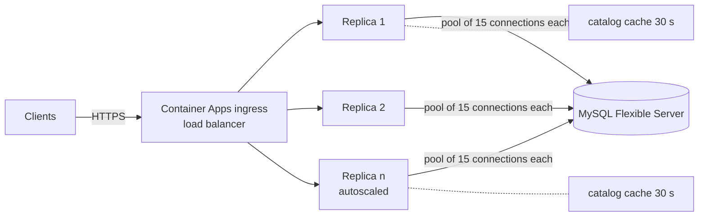

# Trébol backend: scalability plan

How the system handles the evaluation target, where it is expected to break, and what to change, step by step, to
support more requests per second. Numbers come from our measurements (laptop test of 16 Nov 2026, local MySQL
measurements of 17 Nov) and from Azure's published limits and South India list prices; estimates are marked as such
and are to be confirmed by the evaluators' test.

**Evaluation target:** peak **2,500 requests per second**, at least 10,000 requests within 5 minutes, mixed requests,
load raised step by step until the system breaks. Pass criteria of the assignment: P95 < 500 ms, errors < 1%.

## 1. How the system scales

- **Stateless replicas.** Sign-in is a JWT checked in memory (no session, no database lookup per request), so any
  replica can serve any request and replicas can be added or removed at any time.
- **Autoscaling** (KEDA in Container Apps): a replica is added when average CPU goes above 70% or a replica has more
  than 100 requests in flight; replicas are removed again about 5 minutes after the load drops.
- **One shared database.** All writes and the uncached reads go to MySQL; each replica keeps a pool of 15
  connections, so `replicas x 15` must stay below the server's `max_connections`.
- **Catalog cache.** Each replica keeps the public catalog responses (products, categories, product lists) for
  30 seconds. Staff who can edit the catalog always read live data.

## 2. Measurements behind the plan

| Measure | Value | Source |
|---|---|---|
| CPU per browse request (catalog, profile) | about 4.5 ms | 16 Nov, 3 replicas at about 68% CPU |
| CPU per login or sign-up (password hashing, BCrypt strength 10) | about 70 ms | 16 Nov |
| Database queries per browse request | 8.9 before tuning, 3.5 with batch fetching, about 0.5 with the catalog cache (estimate) | 17 Nov, local MySQL 8.4, same requests as the load test |
| Database cost per query (Burstable B1ms) | about 2,000 simple queries per second per vCore at 100% CPU | 16 Nov, 34% CPU at about 660 queries per second |
| Container Apps cores per environment | 100 (2 in use) | Azure quota, 18 Nov |
| Replica start time | 13-45 s | 13-16 Nov |

## 3. Capacity model

- **App:** replicas needed = requests per second x CPU per request / (vCPU per replica x 0.7).
  The login share dominates: average CPU per request = 4.5 ms + login share x 70 ms.
- **Database:** queries per second = requests per second x queries per request; connections = replicas x 15.
- **Quota:** replicas x vCPU per replica (plus the overlap of two revisions during a release) must stay below 100
  cores per environment.

| Login share in the mix | Average CPU per request | 2 vCPU replicas needed at 2,500 requests per second | Ceiling with 20 replicas |
|---|---|---|---|
| 0% (browsing only) | 4.5 ms | 8 | about 6,200 requests per second |
| 5% | 7.8 ms | 14 | about 3,600 requests per second |
| 10% | 11.1 ms | 20 | about 2,500 requests per second |
| 20% | 17.6 ms | 32 (above the maximum) | about 1,600 requests per second |

The catalog cache lowers the browse cost below 4.5 ms (cached answers skip the database and Hibernate), so the
browsing rows are conservative.

## 4. Levels

| Level | Throughput | App | Database | Other changes | Expected first limit | Cost per hour (estimate) |
|---|---|---|---|---|---|---|
| **0: development (now)** | about 250 requests per second | 1-3 replicas of 1 vCPU / 2 GiB | Burstable B1ms (1 vCore, 171 connections, 360 IOPS) | - | Database CPU (and its CPU credits) | about 0.2 USD |
| **1: evaluation (18 Nov)** | 2,500 requests per second | 4-20 replicas of 2 vCPU / 4 GiB (40 cores) | General Purpose D4ads_v5 (4 vCores, 1,365 connections) with Autoscale IOPS | Batch fetching, page size capped at 50, catalog cache, warm minimum of 4 replicas | App CPU at 20 replicas, reached earlier the more logins the mix contains (section 3); the "replicas at the limit" alert shows it | about 3-6 USD |
| **2: 5,000 requests per second** | 5,000 | up to 45 replicas of 2 vCPU (90 of the 100 cores) or 4 vCPU replicas | D4ads_v5 is enough for browsing (about 2,500 queries per second); D8ads_v5 if writes grow | Minimum 8 replicas before peaks; cache time to live 60 s | Environment core quota; login CPU | about 12-18 USD |
| **3: 10,000 requests per second** | 10,000 | 80+ cores: quota increase (environment quota request) | D8ads_v5 or D16ads_v5; a read replica for the uncached reads; ProxySQL when `replicas x pool` passes `max_connections` | **Azure Front Door caching the public catalog at the edge** (most requests never reach the app); a shared cache (Azure Managed Redis) so cache misses do not multiply with the number of replicas | Database writes (sign-ups, orders); single region | about 25-40 USD |
| **4: beyond, or high availability** | 10,000+ | Two regions active-active behind Front Door; dedicated workload profiles or AKS with node pools (planned phase 2) | Zone-redundant high availability; separate databases per region or sharding | Logins in their own service (password hashing scales separately); queue for slow work (orders, e-mails) | Data consistency across regions | per design |

Request charges are included in the costs above (0.40 USD per million requests: 2,500 requests per second for an
hour is 9 million requests, 3.6 USD).

## 5. Levers, cheapest first

| Lever | Effect | Effort |
|---|---|---|
| Longer cache time to live (30 -> 60 s) | Fewer database queries and less CPU; shoppers see catalog changes later | Setting (`TREBOL_CACHE_CATALOG_TIMETOLIVESECONDS`) |
| Warm minimum replicas before a peak | No 30-45 s wait for new replicas; protects P95 during the ramp-up | Repository variable |
| Lower CPU target (70% -> 60%) | Scales out earlier, more replicas | Bicep parameter |
| Larger replicas (2 -> 4 vCPU) | Fewer replicas, more headroom per replica | Bicep parameter |
| Higher maximum replicas, core quota increase | Higher ceiling | Bicep parameter; quota request (free) |
| Larger database (D4 -> D8 -> D16) | More queries per second and connections; 1-2 minutes of restart to change | Bicep parameter |
| Edge cache (Front Door) | Removes most catalog traffic from the app and the database | New resource (monthly base fee) |
| Read replica, ProxySQL | More read capacity; more replicas within the connection limit | New resources |
| Multi-region | Higher ceiling and resilience | Architecture change |

## 6. How the break point is found and read

During the stepped test, the workbook **Trebol API operations** and the alerts show which limit is reached first:

| Signal | Meaning |
|---|---|
| Replicas at the maximum (alert after 10 minutes) and CPU per replica above 70% | App capacity is the limit: raise the maximum or the replica size |
| P95 above 500 ms with CPU below 70% | Waiting elsewhere: check database CPU, connections and query time |
| MySQL CPU close to 100% or connections close to the limit (alert at 80%) | Database is the limit: larger size, more caching |
| Server errors (5xx) above 1% (alert) | Overload or failures: check the platform events tile (restarts, probe failures) |
| Requests per second stop rising while the load generator sends more | Network or ingress limit, or the load generator itself |

## 7. Risks

- **Mix unknown.** The login share decides the ceiling (section 3); a login-heavy test reaches the 20-replica limit
  near 2,500 requests per second.
- **Ramp speed.** New replicas need 13-45 s; a very fast ramp can briefly overload the warm replicas (P95 rises, no
  errors expected).
- **Cache freshness.** Catalog changes reach shoppers within 30 s; staff see them at once.
- **Single region, no database high availability** in this proof of concept (deliberate, for cost).
